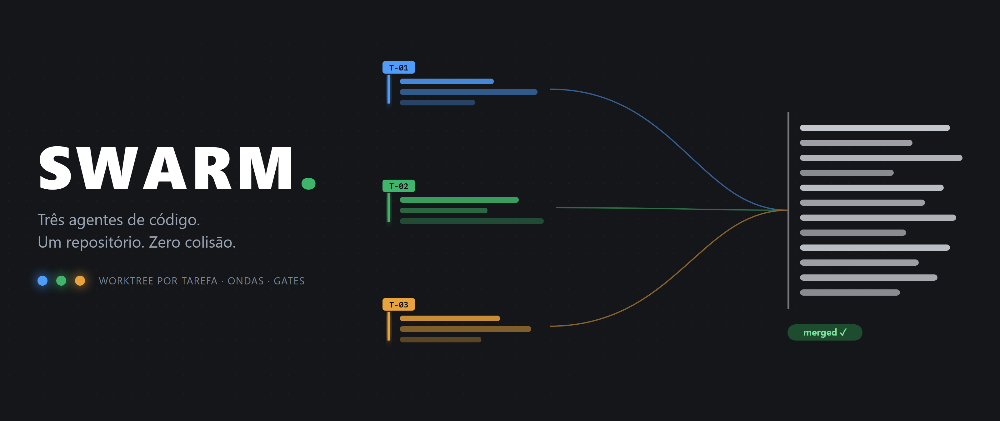
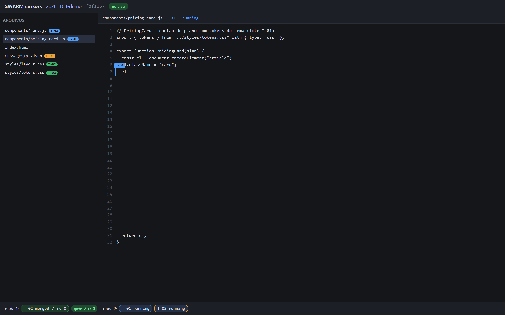
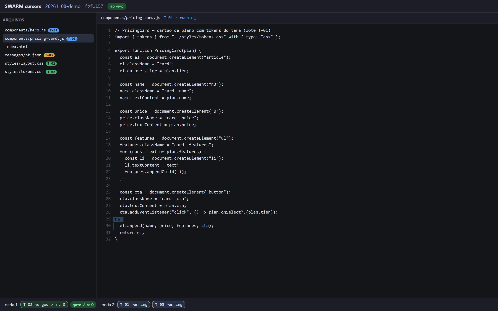
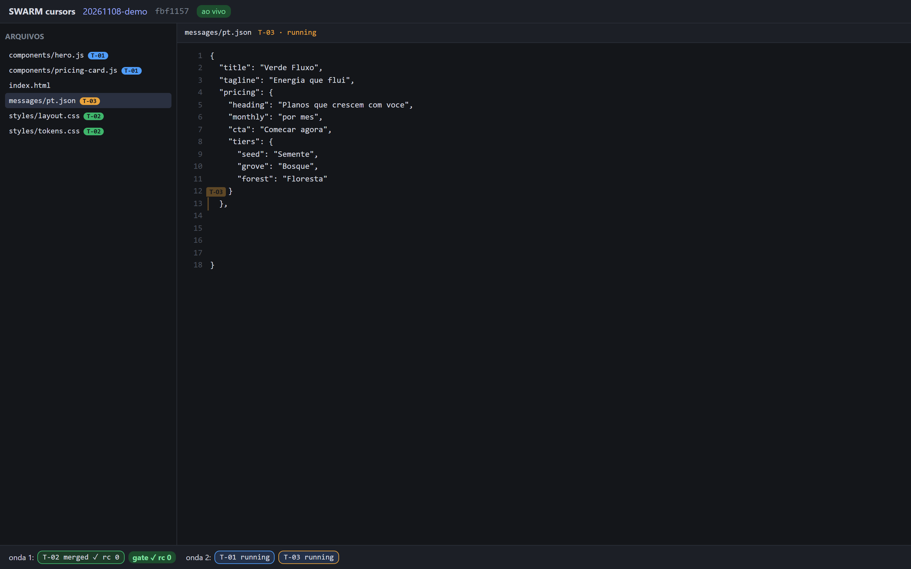

<p align="center">
  
</p>

<h1 align="center">SWARM</h1>

<p align="center">
  <strong>Suíte portátil de swarm multi-agente para construir código em paralelo — com isolamento real, integração determinística e um painel para você assistir aos agentes trabalhando ao vivo.</strong>
</p>

<p align="center">
  = 20">
  
  
  
  
</p>

---

## O que é

**SWARM** conduz um swarm de até **3 agentes de código editando o mesmo repositório ao mesmo tempo**, sem que eles se pisem. A tese central é simples e é o produto inteiro:

> Orquestração de swarm é problema resolvido. **Isolamento e integração são o produto.**

A maioria dos swarms open-source roda todos os workers no mesmo checkout e delega a segurança a uma instrução em prosa ("não toque no arquivo do vizinho"). Isso não é isolamento — é esperança. O SWARM fecha esse buraco com três mecanismos duros:

1. **Um worktree git por tarefa.** Cada agente escreve numa cópia física separada do repo. Ninguém divide checkout.
2. **Lotes declarados e verificados.** O plano declara que diretórios cada tarefa possui; sobreposição na mesma onda recusa o plano *antes* de qualquer worktree nascer. Na volta, a gate compara o diff real com o lote declarado — quem atravessou a fronteira não entra na integração.
3. **Ledger single-writer append-only.** Um único dono do estado (`run.js`) escreve `status.tsv`. Toda falha vira um estado no ledger, nunca um sucesso fingido.

Em cima disso: **ondas** derivadas de dependência (a onda N+1 só abre depois de a N integrar), **gates** de qualidade que bloqueiam, e o **swarm-cursors** — um painel local, read-only, onde você vê cada agente com um **cursor nomeado e colorido** escrevendo no arquivo dele, em tempo real.

<p align="center">
  
</p>
<p align="center"><em>O painel ao vivo: o cursor azul <code>T-01</code> revelando o componente linha a linha; à esquerda a árvore com o dono de cada arquivo; embaixo a faixa de ondas com <code>T-02 merged ✓</code>, o gate da onda 1 e as duas tarefas rodando na onda 2.</em></p>

---

## Features

| | Feature | O que faz |
|---|---|---|
| 🌳 | **Worktree por tarefa** | Isolamento físico por cópia git; nunca checkout compartilhado |
| 🎯 | **Lotes por diretório** | Plano recusa sobreposição antes do spawn; gate confere diff real vs lote |
| 🌊 | **Ondas topológicas** | `depends_on` vira ondas; onda seguinte só abre após integrar a atual |
| 🧾 | **Ledger single-writer** | `status.tsv` append-only; toda falha vira estado auditável |
| 🚦 | **Gates que bloqueiam** | Gate de tarefa e de onda barram integração; crítica estética é advisory |
| 🔁 | **Retry numerado** | Prompt imutável por attempt; falha cria `attempt-2`, não reescreve história |
| 👀 | **swarm-cursors** | Painel SSE read-only com cursor nomeado/colorido por agente, reveal ao vivo |
| 🧩 | **3 skills curadas** | orchestrator / worker / integrator, prontas para o seu host |
| 📦 | **Zero dependências** | Node puro ESM, sem build, sem `node_modules`; roda em máquina emprestada |
| 🔒 | **Read-only & local** | Painel só GET, bind `127.0.0.1`; nada publica, nada dá push |

---

## Arquitetura

```
                    ┌──────────────────────────────────────┐
   você / host ────▶│  run.js  (CLI dono do estado)        │
                    │  plano · ondas · worktrees · ledger  │
                    │  merge · gates                       │
                    └───────┬──────────────────┬───────────┘
                 dispatch   │                  │  ingestão
           ┌────────────────┴───┐         ┌────▼─────────┐
           │ WORKER 1..3        │         │ INTEGRADOR   │
           │ worktree próprio   │         │ merge em     │
           │ host-nativo OU CLI │         │ ordem topo.  │
           └────────────────┬───         └────┬─────────┘
                             │ report.md      │
                             └────────────────┘
                                     │
                           ┌─────────▼──────────┐
                           │ GATES              │
                           │ build → sloplint   │
                           └─────────┬──────────┘
                                     │ SSE (read-only)
                           ┌─────────▼──────────┐
                           │ swarm-cursors      │
                           │ painel no browser  │
                           └────────────────────┘
```

O **host** (Qoder, Claude Code, Codex, Cursor) ou um CLI fallback é o *músculo*: executa um prompt dentro do diretório que o `run.js` escolheu e devolve um relatório. Toda **decisão** — o que roda, quando, em que cópia, se passa — é do CLI. O `start` **não faz spawn**: ele prepara worktree + prompt e imprime o JSON que o host entrega ao subagente.

---

## Instalação

Pré-requisitos (só isso):

- **Node.js ≥ 20** (ESM nativo; sem build).
- **Git** no PATH, com identidade configurada — o merge de produção exige as duas metades:
  ```bash
  git config --global user.email "voce@exemplo.com"
  git config --global user.name  "Seu Nome"
  ```

Passo a passo:

```bash
# 1. clone
git clone https://github.com/Victor-Enginner/Humanity-MCP-skill.git swarm
cd swarm

# 2. NÃO há npm install: zero dependências, zero node_modules, zero build.

# 3. confirme que está tudo verde (170 testes, herméticos, repo git temporário por teste)
node --test "test/"*.test.js
```

> **Windows:** use Git Bash ou PowerShell com git no PATH. Os caminhos são normalizados para absolutos na fronteira do CLI (lição de um bug real de worktree nascendo dentro do repo alvo).

---

## Reproduzir o funcionamento (passo a passo)

Este walkthrough cria um site de brinquedo, planeja duas tarefas em lotes disjuntos, roda uma onda com dois "workers" e integra — e você assiste no painel.

### 1. Prepare um repo alvo

```bash
mkdir demo-site && cd demo-site
git init -q
git config user.email "voce@exemplo.com"
git config user.name  "Seu Nome"
mkdir components styles
echo "export const card = () => {};" > components/card.js
echo ":root { --bg: #fff; }"        > styles/tokens.css
git add . && git commit -qm "base"
cd ..
```

### 2. Inicie o run

```bash
node run.js init --repo ./demo-site --workspace ./swarm-work
```

Imprime o JSON do run. **Guarde o `runDir`** — é ele que passa em `--run` em todo comando seguinte:

```json
{ "runId": "20261108-a1b2", "runDir": ".../swarm-work/runs/20261108-a1b2",
  "repoDir": ".../demo-site", "baseSha": "…", "createdAt": "…" }
```

### 3. Escreva o plano

Crie `plan.md`. Cada tarefa é uma seção `## T-NN <título>` com `- paths:` (o lote, **sempre terminado em `/**`**), `- depends_on:` e `- verify:`; a prosa abaixo é a especificação que vai ao prompt do worker:

```markdown
## T-01 cartao de preco
- paths: components/**
- depends_on: -
- verify: -

Implementar o cartao de preco em components/card.js: nome, preco, lista de
features e CTA. Cores so via tokens do tema; nada de hex literal.

## T-02 tokens do tema
- paths: styles/**
- depends_on: -
- verify: -

Definir os tokens de cor e espacamento em styles/tokens.css.
Este lote e o contrato que os componentes consomem.
```

### 4. Valide e grave o plano

```bash
node run.js plan --run <runDir> --file plan.md
# → { "tasks": 2, "waves": [ ["T-01","T-02"] ] }
```

Lotes disjuntos + sem dependência ⇒ as duas tarefas caem na **mesma onda** (paralelo). Se dois lotes se sobrepusessem na mesma onda, o plano seria recusado com rc 2 aqui.

### 5. Suba o painel (antes de startar, para ver tudo ao vivo)

```bash
node panel/server.js --run <runDir>
# → { "url": "http://127.0.0.1:4180", "runDir": "…" }
```

Abra **http://127.0.0.1:4180** no browser. Você verá a árvore de arquivos, a faixa de ondas e, assim que um worker editar, o cursor nomeado/colorido dele revelando o código.

### 6. Starte as tarefas da onda 1

```bash
node run.js start --run <runDir> --task T-01
node run.js start --run <runDir> --task T-02
```

Cada `start` cria o worktree + branch, grava o prompt imutável em `tasks/<id>/attempt-1/prompt.md` e imprime:

```json
{ "task": "T-01", "workDir": ".../worktrees/T-01", "branch": "swarm/…/T-01",
  "prompt": ".../tasks/T-01/attempt-1/prompt.md", "attempt": 1 }
```

**Entregue esse prompt a um worker cujo único trabalho é operar naquele `workDir`.** Duas formas:

- **Com um host de IA (o caminho real):** despache um subagente (Qoder/Claude Code/Codex…) com o conteúdo de `prompt.md` e cwd = `workDir`. Ele edita só dentro do lote dele; o painel mostra o cursor dele ao vivo.
- **Sem host, para smoke-test:** você mesmo edita os arquivos dentro de `workDir` (ex.: `components/card.js` no worktree de T-01). O watcher do painel emite o edit e o cursor revela — exatamente como no screenshot acima.

### 7. Feche cada tarefa (gate de tarefa)

Quando o worker terminar, registre o rc que o dispatcher devolveu:

```bash
node run.js finish --run <runDir> --task T-01 --attempt 1 --rc 0
node run.js finish --run <runDir> --task T-02 --attempt 1 --rc 0
```

- `--rc 0` roda a gate de tarefa (build/typecheck + sloplint + coerção de lote).
- `--rc 124` = o host matou o worker no tempo dele ⇒ estado `timeout`.
- outro não-zero ⇒ `failed` com o rc registrado.
- O JSON de saída (`ok`, `findings`, `blocked`, `touched`) sai com exit 0: **veredito de gate é dado, não erro de CLI.** Um achado `SCOPE-OUTSIDE-LOT` significa que o agente atravessou o lote ⇒ a branch dele **não** entra; relance com `start --attempt 2`.

### 8. Integre a onda

Com a onda toda `gated`:

```bash
node run.js integrate --run <runDir>
# → { "merged": ["T-01","T-02"], "conflicts": [], "build": … }
```

Merge em ordem topológica na branch de integração; colisão é **reportada**, não resolvida às cegas. A faixa do painel mostra `merged ✓` e o gate da onda.

### 9. Leia o estado e siga para a próxima onda

```bash
node run.js status --run <runDir>
```

Imprime uma linha por linha do ledger (o histórico inteiro) + `{crashed:[…]}` só quando há crash real. A onda N+1 só libera depois do `integrate` da N: um `start` de tarefa dependente antes disso recusa com rc 2 ("rode integrate primeiro") — e o worktree da onda seguinte já nasce do head da integração, com o código das dependências dentro.

### 10. Limpe quando quiser

```bash
node run.js abort --run <runDir>   # remove worktrees + refs swarm/*, preserva o ledger
```

---

## O painel swarm-cursors em detalhe

<p align="center">
  
</p>

- **Um arquivo aberto por vez.** Default *follow*: abre o arquivo do último edit. Clicar num arquivo da árvore **pina** e desliga o follow.
- **Cursor nomeado e colorido do dono**, na linha do edit, com reveal de ~30 chars/frame (a sensação de ver o agente digitando).
- **"pensando…"** aparece após >3 s sem edit com a tarefa `running`.
- `merged` / `failed` / `timeout` escondem o cursor; a faixa mostra `merged ✓`.
- Binário / truncado (64 KB) / removido viram marcador, não lixo na tela.
- **Faixa de ondas** embaixo: cada onda com seus chips de tarefa (estado + rc) e o badge do gate (`gate ✓ rc 0` / `gate ✗` / `gate timeout`).
- **SSE com replay:** ring de 500 eventos; reconexão com `Last-Event-ID` recebe o gap na ordem; gap fora do ring ⇒ `reset` e o cliente rebusca o snapshot. EventSource reconecta sozinho.
- **Read-only de verdade:** só GET (qualquer outro método ⇒ 405), bind só em `127.0.0.1`, path de arquivo validado (traversal/absoluto/backslash/fora-da-tree ⇒ 400). Conteúdo de arquivo é não-confiável: todo texto entra por `textContent`, nunca `innerHTML` com dado.

<p align="center">
  
</p>
<p align="center"><em>Cada lote tem sua cor: azul <code>T-01</code>, verde <code>T-02</code>, âmbar <code>T-03</code>. Aqui o cursor âmbar revela o copy enquanto a faixa mantém o estado das ondas.</em></p>

---

## As três skills

Em `skills/`, prontas para o seu host ler como SKILL.md:

| Skill | Papel | Regra de ouro |
|---|---|---|
| `swarm-orchestrator` | Planeja, starta, lê o ledger, integra | **Nunca edita o produto**; o dispatcher é o host, o dono do estado é o `run.js` |
| `swarm-worker` | Opera **só** dentro do `workDir` do lote dele | Nunca integra, nunca toca fora do lote; reporta o que tocou/rodou/aprendeu |
| `swarm-integrator` | Merge em ordem topológica + gates de onda | Colisão é reportada com os dois lados, não resolvida às cegas |

---

## Gates de qualidade

Ordem determinística; cada degrau só roda se o anterior passou.

| Gate | Roda | Severidade |
|---|---|---|
| Por tarefa | build/typecheck + sloplint + coerção de lote | **bloqueia** o "pronto" do worker |
| Por onda | build + sloplint dos CSS tocados, na página integrada | **bloqueia** a onda seguinte |
| Final (percepção) | medição no browser + crítica por blueprint | *advisory* — roadmap M4 |

O **sloplint** é sem LLM: regras próprias em regex/CSSOM (gradiente roxo de template, rótulo em CAIXA ALTA com tracking largo, ritmo de espaçamento quebrado, cor fora do token). Todo achado sai com um `id` citável, para worker e crítico discordarem do número e não da impressão.

---

## Estrutura do repositório

```
run.js                  # CLI dono do estado: init|plan|start|finish|integrate|status|abort
lib/
  plan.js               # parse do plan.md, ondas topológicas, recusa de sobreposição
  ledger.js             # status.tsv append-only single-writer
  isolate.js            # worktree por tarefa, branch, merge em ordem, remoção
  meta.js               # run.json (runId, repoDir, baseSha)
  report.js             # parse do report.md + coerção de lote (touched vs declarado)
  gate.js               # gate de tarefa e de onda
  sloplint.js           # rule-set SLOP-* sem LLM, achados com id
  briefing.js/prompt.js # floor + tema + convenções → prompt imutável por attempt
  paths.js              # scopeDir / sobreposição de lotes
panel/
  server.js             # HTTP GET-only + SSE (ring 500, replay/reset), 127.0.0.1:4180
  watch.js              # fs.watch + debounce + diff line-based → edit/delete
  ledger-watch.js       # poll do ledger → state/gate
  public/               # index.html · app.js · core.js · style.css (viewer próprio)
skills/                 # orchestrator · worker · integrator (SKILL.md)
seed/                   # floor.md, temas, ATTRIBUTION.md
test/                   # 170 testes herméticos (node:test)
docs/                   # specs, plans, dry-runs, imagens deste README
```

---

## Testes

```bash
node --test "test/"*.test.js     # 170 verdes, ~90 s
```

Unitários da função de ondas (pura, milissegundos), integração com repo git fixture (3 lotes disjuntos → 3 worktrees → merge topológico; tarefa sabotada tocando fora do lote ⇒ gate reprova e a branch não entra), injeção de falha (worker morto ⇒ `crashed`, nenhum merge parcial), e os testes do painel (watcher, ledger-watch, servidor SSE, estáticos). Cada teste cria e limpa o próprio repo temporário.

---

## Status & roadmap

| Marco | Escopo | Estado |
|---|---|---|
| **M1** | Suíte fina sobre o host: skills + contratos de arquivo + worktree + gates 1‑2 + CLI | ✅ **completo** (135 testes + dry-runs reais) |
| **M3‑cursors** | Painel espectador SSE read-only com cursores nomeados | ✅ **completo** (170 testes no total + verificação visual headed) |
| **M2** | Supervisor MCP stdio com as 12 tools como processo real | 🔜 planejado |
| **M4** | Gates de percepção (browser real + blueprint) e teste golden | 🔜 planejado |
| **M5** | Backend CLI dispatcher para máquina sem host | 🔜 planejado |
| **Pendrive** | `iniciar.ps1`/`eject.ps1`, chaves cifradas, binários pré-baixados | 🔜 planejado |

Sendo honesto: **hoje este repo entrega o M1 + o painel.** O servidor MCP de 12 tools, os gates de percepção no browser e o runtime de pendrive são os próximos marcos — cada um ganha plano próprio depois de o anterior rodar. Nada aqui promete o que ainda não foi construído.

---

## Garantias de segurança

- **Nada publica.** Nenhum comando dá push, move `main` ou deleta fora do diretório de execução. Publicação é gesto humano.
- **Painel read-only:** só GET, bind `127.0.0.1`, path validado, conteúdo não-confiável sanitizado por `textContent`.
- **Single-writer:** só o `run.js` escreve o estado; recriar ledger é recusado por propósito.
- **Prompt imutável por attempt:** falha não reescreve história; cria `attempt-2`.
- **Toda falha vira estado** no ledger (`failed`, `timeout`, `crashed`, `discarded`), nunca sucesso fingido.

---

## Atribuição & licenças

Nenhuma linha de código-fonte externo foi copiada para este repositório. O que entrou das fontes estudadas é **regras, ids, mecânica e vocabulário** — descritos, reimplementados e verificáveis por teste aqui dentro. O registro completo, fonte a fonte (incluindo as duas sem licença cuja barreira é a reimplementação), está em [`seed/ATTRIBUTION.md`](seed/ATTRIBUTION.md).

---

<p align="center">
  <strong>SWARM</strong> · isolamento e integração são o produto · feito para assistir ao swarm construir na sua frente.
</p>